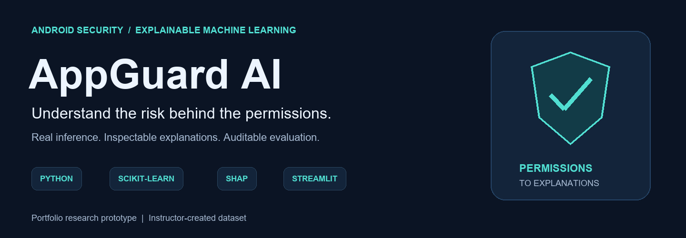
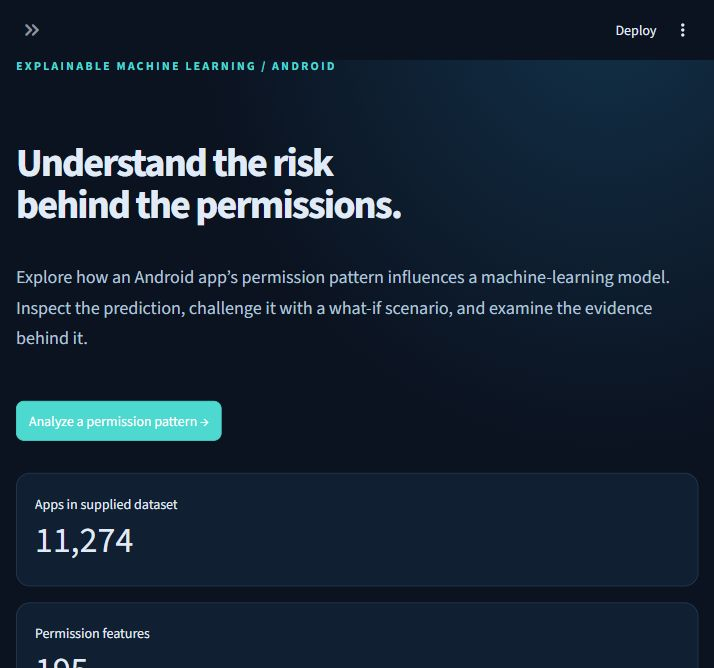
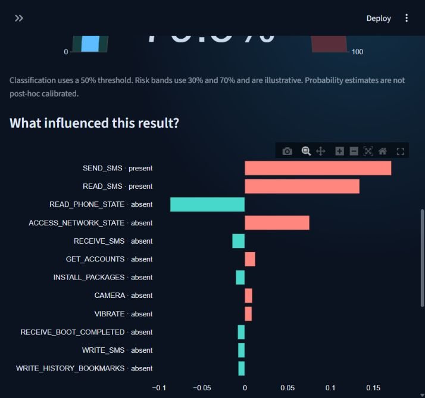
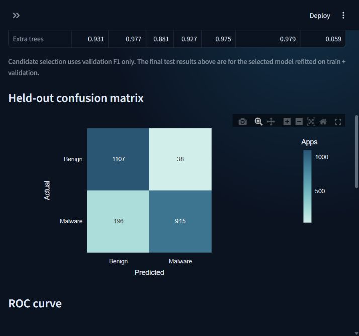
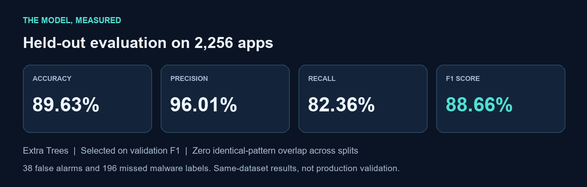
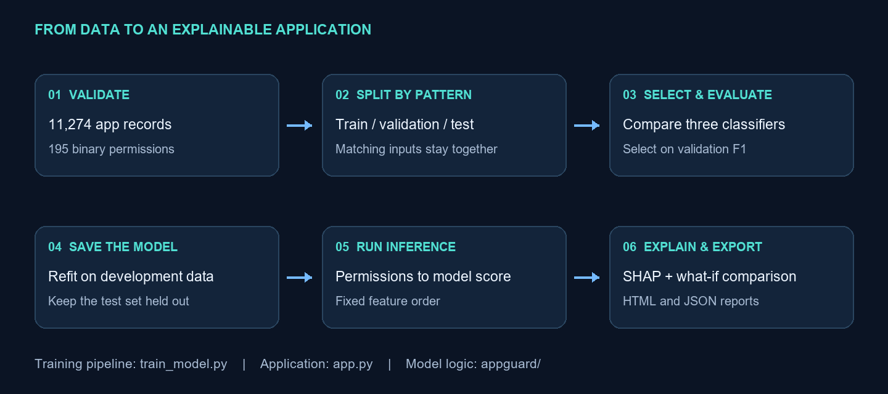

<div align="center">



# AppGuard AI

### Explainable Android permission classification

Learn from real data. Inspect a prediction. Understand the evidence.

**Python 3.12 · scikit-learn · SHAP · Streamlit · Plotly**

[Project guide (PDF)](docs/PROJECT_GUIDE.pdf) · [Screenshots](#see-the-application) · [Results](#measured-results) · [Run locally](#run-locally) · [Model card](MODEL_CARD.md)

</div>

## The project in 30 seconds

Android apps request permissions to access things such as the camera, text messages and internet. **AppGuard AI learns patterns in those requests and estimates whether a permission set resembles benign or malware-labeled apps.** It then explains which inputs influenced the model's score.

This project connects an end-to-end ML pipeline to an interactive application: data validation, model comparison, held-out evaluation, real inference, local explanations and downloadable reports.

| Question | Answer |
|---|---|
| What goes in? | A selected or pasted list of Android permissions. |
| What comes out? | A malware-class probability, pattern classification and SHAP explanation. |
| What data was used? | 11,274 instructor-supplied app records with 195 binary permission features. |
| Which model was selected? | Extra Trees, using validation F1 before final test evaluation. |
| Can I try it online? | A public live demo is not deployed yet. Explore the screenshots or run locally with authorized data/model files. |
| Is this an antivirus? | No. It analyzes permission patterns; it does not scan APKs or guarantee app safety. |

**For a quick review:** look at the screenshots, read the results, then inspect [the training pipeline](train_model.py) and [inference code](appguard/inference.py). The [plain-language PDF](docs/PROJECT_GUIDE.pdf) explains the project without requiring ML knowledge.

## See the application

These are screenshots of the working local Streamlit application, not design mockups. Click an image to enlarge it.

<table>
  <tr>
    <td width="50%"><b>01 · Explore the project</b><br/>Dataset statistics and a clear entry point for analysis.<br/><a href="assets/overview.png"></a></td>
    <td width="50%"><b>02 · Understand the prediction</b><br/>Local SHAP contributions from present and absent permissions.<br/><a href="assets/explanation.png"></a></td>
  </tr>
</table>

<details>
<summary><b>03 · Inspect the model's errors</b></summary>

The evaluation dashboard exposes false positives and false negatives instead of showing accuracy alone.



</details>

### What a user can do

| Capability | Why it matters |
|---|---|
| Select or paste permissions | Uses the actual trained schema; unknown names are reported. |
| Run real model inference | Predictions come from the saved classifier, not hardcoded examples. |
| Inspect local SHAP explanations | Shows contributions to a specific prediction, including absent permissions. |
| Compare a what-if permission set | Reveals model sensitivity without claiming that a lower score proves safety. |
| Review model evidence | Validation comparison, test metrics, ROC/PR curves, reliability and data audit. |
| Download HTML or JSON reports | Captures inputs, outputs, model version, explanations and limitations. |

## The engineering decision that matters

**Keep identical permission patterns out of different dataset splits.**

The dataset contains 11,274 app records but only **3,273 unique permission patterns**. A random row split could place matching inputs in both training and test, making memorization look like generalization.

This project groups identical permission vectors before splitting. Even the **85 patterns with conflicting labels** stay together. App IDs and labels never enter the feature matrix.

| Split | Apps | Distinct patterns | Purpose |
|---|---:|---:|---|
| Training | 6,765 | 1,995 | Fit candidate models |
| Validation | 2,253 | 617 | Select the model using F1 |
| Test | 2,256 | 661 | Evaluate the selected, refitted model |

The winning model is refitted on training + validation. **The final model never trains on the test set.** Pattern overlap across all split pairs is zero. This addresses exact-pattern leakage; it does not establish robustness to new malware families or future data.

## Measured results



**Extra Trees** was selected at a fixed 0.5 classification threshold. Malware is the positive class. Test ROC-AUC is **0.9704**, average precision **0.9741**, and Brier score **0.0767** (lower is better).

| Actual / Predicted | Benign-like | Malware-like |
|---|---:|---:|
| Benign | 1,107 correct | 38 false alarms |
| Malware | 196 missed | 915 detected |

**Interpretation:** high precision means relatively few false alarms among flagged apps. Recall is lower: the model missed 196 malware-labeled test apps. These results describe this dataset and split, not a production security evaluation.

<details>
<summary><b>Model comparison and uncertainty</b></summary>

Candidate scores below are **validation** scores, not final test scores.

| Candidate | Validation precision | Validation recall | Validation F1 |
|---|---:|---:|---:|
| Prior-only baseline | 0.00% | 0.00% | 0.00% |
| Logistic regression | 94.80% | 90.27% | 92.48% |
| Random Forest | 97.80% | 88.02% | 92.65% |
| Extra Trees | 97.70% | 88.11% | **92.66%** |

The prior baseline predicts the majority class at a 0.5 threshold, so its malware recall and F1 are zero. Extra Trees narrowly wins over Random Forest; this tiny difference is not evidence of universal model superiority.

Test F1's 95% group-bootstrap interval is approximately **80.3%-93.8%**, from 500 resamples of whole test groups. It reflects test-sample variability, not all uncertainty from training, collection or distribution shift.

Model version: `1.0-c5031aa16b`. Full local evidence is generated in `models/metrics.json`. Test predictions and the split manifest support independent checks. The prior research accuracy of 95.15% is not claimed as reproduced.

</details>

## How it works



1. **Validate:** read the workbook; check labels, binary values, missing data and identifiers.
2. **Split:** keep identical input vectors together using stratified group splitting.
3. **Compare:** fit three classifiers plus a prior baseline; select by validation F1.
4. **Evaluate and save:** refit on development data, test once, save the model and audit artifacts.
5. **Infer:** turn selected permissions into the exact ordered 195-feature vector.
6. **Explain:** compute local SHAP contributions and export a readable report.

For the selected tree model, SHAP starts from a reference probability and allocates the difference across features. The app checks that **baseline + all contributions = model output** within numerical tolerance. The background consists of 100 development rows. Explanations describe model associations, not causal effects.

## Run locally

**Prerequisite:** Python 3.12 and an authorized copy of the instructor workbook, or trusted matching model artifacts. This source package does not grant permission to redistribute the dataset. A source-only checkout cannot make predictions until the model is trained or supplied.

```bash
git clone https://github.com/sathwik5157/appguard-ai.git
cd appguard-ai
python -m venv .venv
```

Activate the environment:

```powershell
# Windows PowerShell
.\.venv\Scripts\Activate.ps1
```

```bash
# macOS / Linux
source .venv/bin/activate
```

Install dependencies, place your authorized `Combined.xlsx` at the repository root, then run:

```bash
python -m pip install -r requirements.txt
python train_model.py --data Combined.xlsx
python -m streamlit run app.py
```

Open `http://localhost:8501` on the same computer. If trusted trained artifacts already exist, skip training. On the prepared Windows workspace, `launch.cmd` starts the app. No paid API or API key is required.

<details>
<summary><b>Windows alternative if activation is blocked</b></summary>

Use the virtual environment directly without changing execution policy:

```powershell
.\.venv\Scripts\python.exe -m pip install -r requirements.txt
.\.venv\Scripts\python.exe train_model.py --data Combined.xlsx
.\.venv\Scripts\python.exe -m streamlit run app.py
```

</details>

### A two-minute demo

Select `INTERNET`, `READ_SMS` and `SEND_SMS`, then choose **Run analysis**. These are demonstration inputs, not a verified malicious app. Inspect the actual score and SHAP chart, download a report, then use the what-if comparison. Finish on **Model evidence** to examine test errors and the data audit.

## Code and verification

| File or folder | Responsibility |
|---|---|
| [`app.py`](app.py) | Interactive Streamlit application |
| [`train_model.py`](train_model.py) | Training, selection, evaluation and saved artifacts |
| [`appguard/data.py`](appguard/data.py) | Input validation and group-disjoint splitting |
| [`appguard/inference.py`](appguard/inference.py) | Feature ordering, prediction and local SHAP |
| [`appguard/report.py`](appguard/report.py) | Escaped, self-contained HTML reports |
| [`tests/`](tests/) | Unit, artifact integration and app tests |
| [`.github/workflows/tests.yml`](.github/workflows/tests.yml) | Automated source tests on push and pull request |

```bash
python -m pytest -q
```

**24 tests passed locally with trained artifacts.** Checks cover feature order, invalid inputs, group separation, metric reproduction, real SHAP additivity, checksums, HTML escaping and app workflows. Source-only CI explicitly skips tests that require unavailable private artifacts; it does not imply the full integration suite ran. See [verification notes](VERIFICATION.md).

## Scope, data and limitations

- **Dataset credit:** instructor-created workbook supplied by the project owner. Collection dates, labeling procedure and redistribution permission remain unverified. The 197 workbook columns include 195 features plus label and ID.
- **Limited signal:** permissions alone do not reveal code execution, network behavior, signatures or malware families. Sensitive permissions can be legitimate.
- **Probability caveat:** scores are not post-hoc calibrated. The 30%/70% display bands are illustrative, separate from the 50% classification threshold.
- **Generalization:** this is a grouped, same-source evaluation. Independent, time-separated validation is still needed.
- **Artifact safety:** load only trusted local model files. The checksum catches mismatched files; it does not make an untrusted pickle safe.

The prepared source package excludes the workbook and trained artifacts pending sharing permission. The model includes sampled feature rows for SHAP, so model sharing also requires consideration. No public live deployment is claimed.

## Further reading

| Document | Best for |
|---|---|
| [Simple project guide (PDF)](docs/PROJECT_GUIDE.pdf) | Beginner-friendly explanation and demo outline |
| [Technical notes](docs/TECHNICAL_NOTES.md) | Detailed methodology and reproducibility |
| [Model card](MODEL_CARD.md) | Intended use, results and limitations |
| [Interview guide](INTERVIEW_GUIDE.md) | Explaining design choices and evaluation |
| [Submission guide](SUBMISSION_GUIDE.md) | Publishing and deployment steps |

**Next improvements:** verify provenance, test on an independent temporal holdout, evaluate calibration, and add static-code or behavioral features. This portfolio demonstrates an ML application and its evaluation; it is not production antivirus software.

