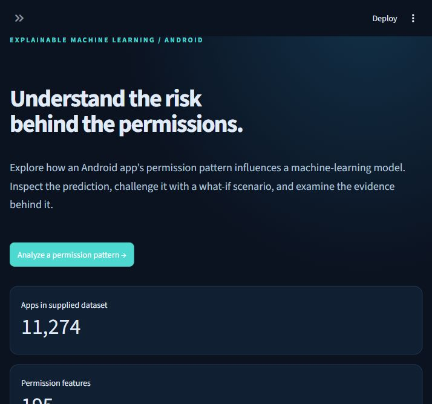
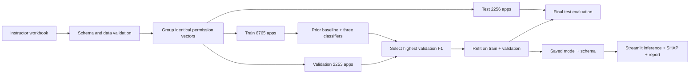

# AppGuard AI

**Explainable Android permission-pattern classification, with an auditable ML evaluation.**

AppGuard AI turns an instructor-created Android permission dataset into an interactive research application. Select or paste permissions, inspect a real model prediction, explain it with SHAP, compare a modified permission set, and export an HTML or JSON report.

The central engineering decision is the evaluation: **identical permission patterns never cross training, validation, or test boundaries**. This matters because the supplied 11,274 rows contain just 3,273 unique patterns. A row-random split could reward memorization of repeated patterns.



## Results

Measured locally on the instructor dataset, seed 42. Extra Trees was selected using validation F1, then refitted on training + validation. The test set was not used for selection or threshold tuning.

| Held-out test metric | Result |
|---|---:|
| Test apps | 2,256 |
| Test permission-pattern groups | 661 |
| Accuracy | 89.63% |
| Malware precision | 96.01% |
| Malware recall | 82.36% |
| Malware F1 | 88.66% |
| ROC-AUC | 0.9704 |
| Average precision | 0.9741 |
| Brier score | 0.0767 |

Confusion matrix (rows = actual, columns = predicted; order = benign, malware): `[[1107, 38], [196, 915]]`. The model misses 196 malware-labeled apps in the test set. High precision does not mean complete malware detection. These are same-dataset results, not evidence of deployment performance or reproduction of a previous 95.15% research result.

## Features

- Dark, responsive Streamlit dashboard with actual dataset and model statistics.
- Searchable permissions and pasted-list import with explicit unknown-permission feedback.
- Fixed-schema inference and model checksum verification.
- Local SHAP explanations, including both present and absent permissions; numerical additivity checks.
- What-if permission comparison, without implying that score reduction makes an app safe.
- Validation leaderboard, test confusion matrix, ROC and PR curves, probability reliability plot, and grouped-bootstrap confidence intervals.
- Data audit: repeated patterns, conflicting labels, class balance, constant columns and split sizes.
- HTML/JSON analysis exports with escaped user-provided text.
- Tests for inference, splitting, artifact integrity, reports and Streamlit interaction journeys.

## Run locally

Use **Python 3.12**. From this directory:

```powershell
python -m venv .venv
.\.venv\Scripts\python.exe -m pip install -r requirements.txt
.\.venv\Scripts\python.exe train_model.py --data Combined.xlsx
.\.venv\Scripts\python.exe -m streamlit run app.py
```

If the local model already exists, skip training. On this prepared computer, double-click **launch.cmd**, or run:

```powershell
.\.venv\Scripts\python.exe -m streamlit run app.py
```

Open `http://localhost:8501`. No API keys or remote inference services are needed. The app performs inference locally; Streamlit may fetch its own frontend assets. Usage telemetry is disabled in project configuration.

On macOS/Linux, replace `.\.venv\Scripts\python.exe` with `.venv/bin/python`. `requirements.txt` pins direct dependencies; `requirements-lock.txt` records the exact full environment used locally. Windows-only packages in the lock file make it an audit record, not a cross-platform install target.

## Data and provenance

The project owner supplied **Combined.xlsx** and identified it as instructor-created. It contains 11,274 rows, labels `Benign` (5,721) and `Malware` (5,553), an app identifier, and **195 binary permission features**. The workbook's 197 total columns are not 197 permission features.

There are no missing values, repeated app IDs or exact duplicate rows. There are 56 constant permission columns in the full dataset, 3,273 distinct permission patterns, and 85 patterns associated with both labels. Repeated patterns from different app IDs are retained as distinct observations and grouped for splitting. Conflicting labels are retained rather than discarded to make the classification task easier.

The original collection process, collection dates, malware-family coverage, label verification method, and permission to redistribute are **not established**. The raw workbook and derived model/evaluation files are excluded from Git by default. Do not infer a public license from possession of the dataset. The project is fully runnable locally; a public clone requires an authorized copy of the dataset or model artifacts.

Dataset SHA-256: `c5031aa16b7df100046d012e955b21c35c061fb628b41745e664957f27858ba8`.

## ML workflow



1. Validate exact labels, binary inputs, missing values and repeated identifiers. Drop exact full-row duplicates, if present. Never include `Apk id` or `File Type` in features.
2. Hash full permission vectors to form groups, including patterns with contradictory labels.
3. Use `StratifiedGroupKFold`: first outer fold (5 folds, seed 42) holds out test; first inner fold (4 folds, seed 43) holds out validation. This approximates 60/20/20 while respecting groups. Seeds are fixed before fitting, not searched for favorable outcomes.
4. Compare a prior baseline, logistic regression, Random Forest and Extra Trees. Use fixed hyperparameters and a fixed 0.5 decision threshold. Select among the three learned models by validation F1.
5. Refit only the selected model on combined train + validation. Evaluate on test once. Save test predictions and the split manifest for independent reproduction.
6. Bootstrap whole test groups 500 times for accuracy/F1 intervals. The intervals reflect held-out sample variability, not training randomness, temporal drift or source bias.
7. Keep the 195-column schema stable. A column constant in development data cannot contribute learned discrimination; inference warns about selected permissions never present in development.

The final artifact is intentionally not refitted on the test set, so displayed test results describe the deployed local model. Scores are not post-hoc calibrated; Brier score and a reliability curve expose calibration quality. Illustrative bands (30%/70%) are separate from the classification threshold (50%).

SHAP uses an interventional tree explainer with 100 development-background rows and probability-space output for tree models. If logistic regression wins after retraining, a linear explainer reports **log-odds**, labeled accordingly. SHAP explains associations in the fitted model, not causal permission effects. If explanation computation fails, the app keeps the prediction and labels the explanation unavailable.

## Project map

```text
app.py                    Streamlit application
train_model.py            Reproducible training and evaluation
appguard/data.py          Validation and group-disjoint splitting
appguard/inference.py     Schema, prediction and SHAP
appguard/report.py        HTML export
models/                   Local trained artifacts and evidence
tests/                    Unit, integration and app tests
.github/workflows/        CI for shareable source
INTERVIEW_GUIDE.md         Project explanation and interview preparation
MODEL_CARD.md             Intended use, evidence and limitations
SUBMISSION_GUIDE.md        Demo, GitHub and deployment checklist
```

## Test

```powershell
.\.venv\Scripts\python.exe -m pytest -q
```

Without the restricted local artifacts, integration and UI tests explicitly skip; unit tests still run in GitHub Actions. Run the complete suite after training. Never load a model supplied by an untrusted third party: joblib uses pickle-based deserialization. The checksum detects accidental file mismatch, not malicious replacement of both model and metadata.

Local verification: **24 tests passed**. See [VERIFICATION.md](../VERIFICATION.md). Create the source-only upload archive with `python package_source.py`.

## Publish and deploy

See [SUBMISSION_GUIDE.md](../SUBMISSION_GUIDE.md). Source can be uploaded without the workbook. A working hosted demo needs permission to redistribute the trained artifact, or an independently licensed replacement dataset followed by retraining and revised results. The app is not currently deployed publicly.

## Limitations and next steps

This is a permission-only research prototype, not an antivirus product. It does not parse APKs, inspect code, observe runtime behavior, identify malware families, or guarantee that an app is safe. Pattern grouping reduces one leakage route but cannot rule out near-duplicates, family leakage or collection-source confounding. Future work should establish provenance, evaluate on an independently sourced and time-separated dataset, use nested grouped validation for tuning, compare calibrated models, and add code/behavior features.

## References

- [scikit-learn cross-validation and grouped data](https://scikit-learn.org/stable/modules/cross_validation.html)
- [SHAP TreeExplainer](https://shap.readthedocs.io/en/stable/generated/shap.TreeExplainer.html)
- [Streamlit AppTest](https://docs.streamlit.io/develop/api-reference/app-testing/st.testing.v1.apptest)

These references document implementation methods; they are not sources for the instructor dataset.
